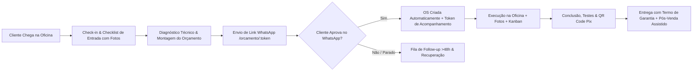

# PRODUCT_MAP — Konnexy OS Auto
**Data:** 04/11/2026  
**Versão:** 1.0.0-production-audit  
**Ambiente:** Staging / Local (`http://localhost:5174`) / Produção Alvo: `https://osauto.konnexy.com.br/`  

---

## 1. Visão Geral do Produto e Arquitetura

O **Konnexy OS Auto** é uma aplicação web SaaS multi-tenant desenvolvida para o segmento automotivo brasileiro (oficinas mecânicas, centros automotivos, estética automotiva/detailing, autoelétricas, funilaria & pintura e troca de óleo rápida).

### Stack Tecnológica Identificada:
- **Frontend SPA**: React 19, TypeScript (~6.0), Vite 8.2, Tailwind CSS 3.4, React Router DOM v7.
- **Ícones & UI**: Lucide React, Canvas-Confetti, QRCode.react, Tailwind-Merge / Clsx.
- **Backend / Persistência**:
  - Híbrido: Cliente Supabase JS configurado (`@supabase/supabase-js`) com fallback completo para `localStorage` mock reativo para desenvolvimento/demonstração imediata.
  - Banco de dados relacional PostgreSQL especificado em `src/supabase/schema.sql` com RLS por tenant (`company_id`), extensões UUID e pgcrypto.
- **Theming & White-Label**: Motor CSS Variables dinâmico em `:root` (`src/lib/theme.ts`) que gera escala HSL/RGB em tempo real nos presets da marca (Azul Konnexy, Verde Esmeralda, Índigo, Laranja, Preto Grafite, Roxo Detailing).

---

## 2. Papéis de Usuário (RBAC) e Matriz de Permissões

| Papel | Descrição | Permissões Principais | Restrições |
| :--- | :--- | :--- | :--- |
| **owner** | Proprietário da Oficina | Acesso total à empresa, usuários, financeiro, configurações e plano | Não acessa dados de outros tenants |
| **admin** | Gerente Geral | Operação total, orçamentos, OS, clientes, configurações e relatórios | Não pode excluir a conta da empresa |
| **attendant** | Atendente / Consultor | Check-in, clientes, veículos, criação e envio de orçamentos, acompanhamento de OS | Sem acesso a relatórios financeiros e configurações da empresa |
| **mechanic** | Mecânico / Técnico | Visualização de OS atribuídas, laudo técnico, checklist e fotos de serviço | Bloqueado para relatórios financeiros, custos e configurações |
| **financial** | Financeiro | Gestão de pagamentos, cobranças, relatórios de faturamento e fluxo de caixa | Bloqueado para alterações operacionais estruturais |
| **superadmin** | Governança Plataforma Konnexy | Painel Master (`/superadmin`): métricas agregadas de MRR, saúde de inquilinos e suporte | Acesso de nível de governança da plataforma SaaS |

---

## 3. Jornadas de Usuário Principais

### Jornadas Mapeadas:
1. **Jornada de Venda Ágil (<60s)**:
   - Atendente seleciona cliente + veículo (ou cadastra rapidamente com placa Mercosul).
   - Aplica pacotes de serviços rápidos ("Revisão Preventiva", "Higienização", "Freios").
   - Dispara proposta interativa no WhatsApp com 1 clique.
2. **Jornada do Cliente Final (Sem Login)**:
   - Recebe link criptografado `/orcamento/:token`.
   - Visualiza itens discriminados, fotos do diagnóstico, valor total e parcelamento.
   - Aprova formalmente (com aceite de termos, registro de nome e IP) ou recusa com motivo.
   - Em caso de aprovação, é direcionado ao portal `/acompanhar/:token` para tracking ao vivo.
3. **Jornada de Execução Operacional da Oficina**:
   - OS aparece no Quadro Kanban em 6 etapas: *Veículo Recebido*, *Diagnóstico Técnico*, *Orçamento Aprovado*, *Serviço em Execução*, *Finalização & Testes*, *Pronto para Retirada*.
   - Mecânico anexa fotos de antes e depois e solicita aprovações adicionais se identificar peças danificadas.
4. **Jornada Financeira & Pós-Venda**:
   - Registro de sinal ou pagamento integral via QR Code Pix (payload EMV padronizado).
   - Fechamento da OS com emissão de recibo de entrega e termo de garantia (90 dias).
   - Fila de agendamento de retorno preventivo (troca de óleo em 6 meses / 10.000 km).

---

## 4. Inventário Completo de Telas e Rotas

| Rota | Tipo | Módulo | Descrição Funcional |
| :--- | :--- | :--- | :--- |
| `/` e `/landing` | Pública | Marketing | Landing page com proposta de valor, fluxo sem fricção e CTAs |
| `/login` | Pública | Autenticação | Formulário de login com persistência e fallback local |
| `/register` | Pública | Autenticação | Cadastro de nova oficina com definição do responsável |
| `/forgot-password` | Pública | Autenticação | Solicitação de recuperação de senha |
| `/orcamento/:token` | Pública | Portal do Cliente | Visualização formal de orçamento, aceite digital e recusa |
| `/acompanhar/:token` | Pública | Portal do Cliente | Portal ao vivo do veículo em atendimento, 6 etapas, fotos e Pix |
| `/onboarding` | Autenticada | Setup Inicial | Assistente passo a passo para configuração da oficina em 3 etapas |
| `/dashboard` | Autenticada | Painel Geral | Indicadores do dia, entrega em risco, checklist e atalhos rápidos |
| `/quotes` | Autenticada | Orçamentos | Listagem, filtros por status, badges de versão (`v1`, `v2`) |
| `/quotes/new` | Autenticada | Orçamentos | Criação ágil com queixa/diagnóstico/solução e pacotes prontos |
| `/quotes/:id` | Autenticada | Orçamentos | Detalhes, histórico de versões imutáveis, eventos e links |
| `/quotes/:id/edit` | Autenticada | Orçamentos | Edição com trava de imutabilidade e criação de nova versão |
| `/quotes/follow-up` | Autenticada | Vendas | Fila de orçamentos parados (>48h) com recuperação WhatsApp |
| `/service-orders` | Autenticada | Ordens de Serviço | Listagem de OS, status, prazos e busca por cliente/placa |
| `/service-orders/kanban`| Autenticada | Oficina | Quadro visual com 6 colunas e contadores de veículos |
| `/service-orders/:id` | Autenticada | Ordens de Serviço | Detalhes completos da OS, laudo, checklist, fotos e pagamentos |
| `/customers` | Autenticada | Clientes | Listagem e busca de clientes PF/PJ com múltiplos veículos |
| `/customers/:id` | Autenticada | Clientes | Ficha cadastral, histórico de orçamentos e OS vinculadas |
| `/vehicles/:id/history`| Autenticada | Veículos | Linha do tempo da vida útil e manutenções do veículo |
| `/reminders` | Autenticada | Pós-Venda | Lembretes de revisão e troca de óleo preventiva com WhatsApp |
| `/reports` | Autenticada | Gestão | Indicadores de conversão de orçamentos, faturamento e serviços |
| `/settings` | Autenticada | Configurações | Dados da empresa, White-label (cores/logo), Pix e templates |
| `/superadmin` | Autenticada | Plataforma SaaS | Governança multi-tenant, lista de inquilinos e métricas de MRR |

---

## 5. Matriz de Promessas de Marketing vs. Realidade do Código

Avaliação minuciosa de cada promessa apresentada na Landing Page e no material promocional:

| # | Promessa de Marketing | Status Real | O que existe | O que falta / Risco |
| :- | :--- | :--- | :--- | :--- |
| 1 | **“Do orçamento ao pagamento, tudo organizado em um só lugar”** | **Implementado** | Fluxo ponta a ponta: Criação de Orçamento $\to$ Aprovação $\to$ OS $\to$ Pagamento Pix/Dinheiro/Cartão $\to$ Conclusão $\to$ Pós-Venda. | Sem emissor fiscal integrado (NFS-e/NFC-e). |
| 2 | **“Envie propostas profissionais com aprovação em 1 clique no WhatsApp”** | **Implementado** | Gerador de link seguro `/orcamento/:token` com template WhatsApp e modal com registro de IP e nome. | Falta assinatura digital desenhada ou token SMS/WhatsApp direto. |
| 3 | **“Acompanhe seus serviços direto pelo celular (Mobile-First / PWA)”** | **Parcial** | Interface responsiva e manifest básico configurado. | Faltam Service Worker ativo, viewport com zoom liberado, splash screens iOS e maskable icons. |
| 4 | **“Ordem de Serviço & Quadro Kanban da Oficina”** | **Implementado** | Kanban completo com 6 colunas, arrasto/mudança de status, contadores e filtros rápidos. | Necessita de trava de concorrência se 2 mecânicos editarem a mesma OS simultaneamente. |
| 5 | **“Receba com QR Code Pix Instantâneo”** | **Implementado** | Motor de payload Pix EMV (`src/lib/pix.ts`) com CRC16 válido, chave da oficina e modal com copia e cola. | Webhook bancário de baixa automática ausente (baixa manual por operador). |
| 6 | **“Pós-Venda e Lembretes de Revisão Automáticos”** | **Implementado** | Módulo de lembretes preventivos com filtros por vencimento de km/data e disparo assistido no WhatsApp. | Disparo é assistido (via link `api.whatsapp.com`), não robô automático via Cloud API. |
| 7 | **“Multiempresa: sua oficina com identidade própria (White-Label)”** | **Implementado** | Motor CSS variables em tempo real, logotipo personalizado e dados da oficina em todas as páginas públicas. | Isolamento em produção depende de ambiente Supabase real configurado com as RLS auditadas. |
| 8 | **“Emissão de Recibos e Termos de Garantia”** | **Implementado** | Recibo imprimível em folha A4 com checklist e prazo de garantia configurável. | Termo de retirada e termo específico para peças recondicionadas ausentes no print. |
